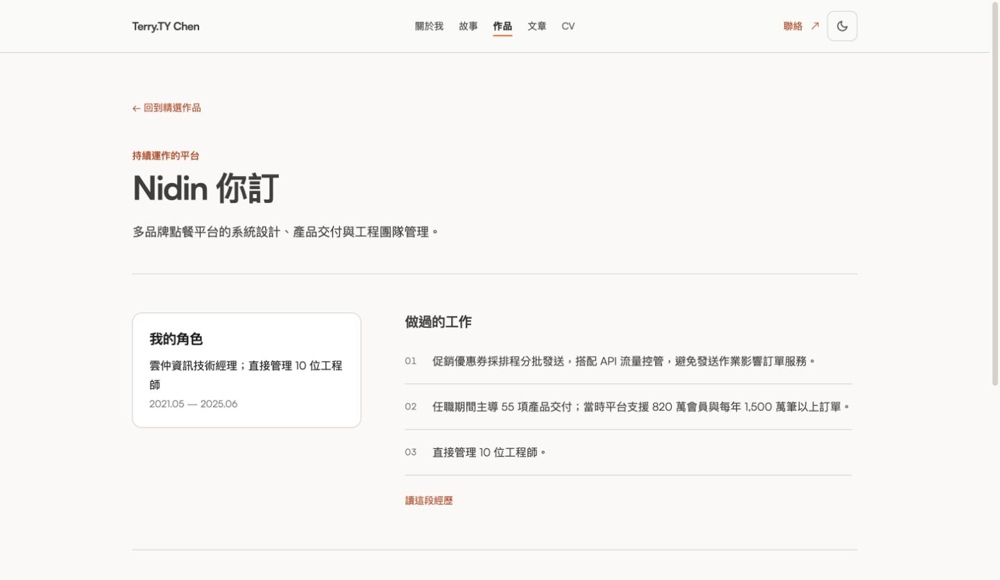

# Personal site design alignment evidence

The correction now synchronises visible copy as well as styling across all 11 selected views. The user's supplied second screenshot matches the deployed old Story copy; PR head `0b68760` also retained that old copy, although it already added chapter index 04 and removed the CTA underline. This was a real omission in the PR, not merely an undeployed change. The follow-up replaces it with the selected Nidin index 02, heading and two paragraphs.

## Authority and isolation

- Read-only Open Design project: `/Users/terrychen/Library/Application Support/Open Design/namespaces/release-stable/data/projects/76e33fa9-e2bc-4bf3-b92d-b38f0e5c0ae2`.
- Selected `index.html` changed on 2026-10-15 at 11:16:19 as displayed on Terry Mac. SHA-256 `eacf76941bf1678d81ba4a5c37ad08a0109c0e15499d945fd44dcd3216fd2792`. CSS remains `ba613c8131c763be6cd65f44e482d19e0c04c981f3cf5835912fe8ebd09be784`; JS remains `5637dc6b4f238c8c23cfe8b99f35ce88219133a669a4ed352c0db2ee699beef7`.
- The user's follow-up explicitly supersedes the earlier copy/order preservation assumption. The user separately confirmed every skill in both reference CV taxonomies on 2026-10-15. No original design file was edited.
- Product folder `.me` maps to the existing canonical remote `terry90918/terry90918.github.io`. `gh repo view`, repository ID `1200529039`, and PR #110 confirm that mapping. No remote was changed.
- Base `e015163cdde905be12e6c20e7bbd79aefba7dd71`; dedicated branch `codex/jur-705-design-alignment` under this task's `site-alignment` worktree. Main and its untracked content remain untouched.
- No AGENTS.md exists in the inspected root, ancestor chain or tracked project directories. CLAUDE.md, current OpenSpec/tests, DESIGN.md, JT Harness 2.2.6 and applicable design/worktree skills were read. Managed worktree creation was unavailable; the skill's Git fallback created the isolated checkout.
- Existing JUR-705 and PR #110 are reused. No duplicate issue or PR, second complete review, merge or deployment.

## Per-view correction

| View → route                   | Copy and structure now applied                                                                                                                                | Main implementation                      |
| ------------------------------ | ------------------------------------------------------------------------------------------------------------------------------------------------------------- | ---------------------------------------- |
| Shared shell                   | Centered five-link navigation, separate contact, 44px controls, shared content edges, neutral text footer                                                     | BlogHeader, BlogFooter, editorial.css    |
| home → `/`                     | GJ, Nidin, AI experience order; exact headings/summaries; GJ, Nidin, JurisLM work order; reference contact copy                                               | site/content.ts, SiteContact             |
| about → `/about`               | Title 關於我, exact three introduction paragraphs and inline reading paths, short public account captions                                                     | about/page.tsx                           |
| story → `/story`               | Three chapters in GJ/Nidin/AI order; Nidin 02, 在 Nidin，做系統，也帶團隊, exact two paragraphs; selected GJ/AI paragraphs                                    | site/content.ts, story/page.tsx          |
| work → `/work`                 | Product/platform/AI numbered groups; concise GJ/Nidin/JurisLM summaries; VClass and Channel-T supporting cards; remove old main-site TPI expansion            | site/content.ts, work/page.tsx           |
| work-gj → `/work/gj`           | GJ title and concise reference summary; existing verified role, dates and delivery evidence                                                                   | work/[slug]/page.tsx                     |
| work-nidin → `/work/nidin`     | Reference summary, role, date and evidence layout; confirmed 55-delivery statement restored verbatim in evidence row 02                                       | work/[slug]/page.tsx                     |
| work-jurislm → `/work/jurislm` | Reference concise summary, role and evidence; retain sampled-recall qualification                                                                             | work/[slug]/page.tsx                     |
| posts → `/posts`               | Reference intro, topic chips, month/count hierarchy, neutral article headings and metadata badges; current article data                                       | WritingPostCard, posts/page.tsx          |
| ai-daily → `/posts/ai-daily`   | Correct AI 日報 eyebrow and back-link arrow; reference lead; current 77 published daily rows                                                                  | posts/ai-daily/page.tsx                  |
| cv-zh-TW → `/cv`, `/cv/zh-TW`  | 自由工作者; reference section labels, six concise project cards, exact history presentation, education/contact/skills order and 31 confirmed skill categories | design-reference.json, CvHome, CV layout |
| cv-en → `/cv/en`               | Freelancer; same full presentation in English, including six reference project summaries and 31 confirmed categories                                          | same shared CV components                |

The shared warm-white/charcoal/orange palette, Satoshi fonts, 1120px outer maximum, 32px desktop/20px mobile padding, 700px/900px breakpoints, framed portraits, 14px cards, 10px buttons, numbered split sections and fine-line chronology follow the selected CSS. Current 3D/physics ownership and mobile photo fallback are preserved. Full career details, including TPI, remain in CV; article bodies and CV case-study/contact detail bodies have no selected prototype and retain their existing structures.

## Copy audit and exceptions

[Full source → implementation → status audit](2026-10-15-design-copy-audit.md) contains 858 entries across all 11 views, including repeated shared-shell checks. 853 static text checks match within their mapped sections, with zero unexplained missing blocks. Whitespace and decorative arrows/plus signs are ignored. This check does not prove visual geometry, ordering or absence of extra copy; source inspection, order tests and browser evidence are separate.

- Three dynamic slots intentionally use current published article data: 3 home updates, 92 archive rows and 77 daily rows. The prototype's 71-post snapshot is not frozen into the product. Dates, excerpts, classification and translation attribution continue to come from real content.
- The user subsequently confirmed the remaining 55-delivery fact. Nidin evidence row 02 now matches the original statement verbatim: `任職期間主導 55 項產品交付；當時平台支援 820 萬會員與每年 1,500 萬筆以上訂單。`. Its former copy exception is removed. No other achievement or placement was added.
- Two prototype badge-name entries belong to its static 3D placeholder. The real card implementation and its mobile fallback are retained instead.
- `scripts/sync-design-reference.mjs <selected-index.html>` captures both CV presentations with the HTML hash. Navigation receives only the server-selected labels, rather than importing the full snapshot into its client bundle. `scripts/check-design-reference.mjs <selected-index.html> <output.json>` checks the production export.

## Checks and real browser evidence

- Full lint and TypeScript checks passed. Full suite passed 102/102 tests across 16 files with `bun run test --maxWorkers=1`. Earlier default-concurrency runs hit the existing five-second content-loading timeout; timeout/test configuration was not changed.
- OpenSpec validation passed 10/10. Its CLI subsequently reported an analytics network-flush error with exit 0. No telemetry/config changes were made.
- Production build passed, including 125 static pages and CV export aliases. The sandbox-only build could not bind Turbopack's worker port, so the same authorised build ran outside the sandbox. `git diff --check` passed.
- Normal Chrome, through the existing CUA tool, displayed actual desktop screenshots of all 11 views. Story and Work full-page screenshots were inspected. About, case pages, archive/daily first viewports and CV heroes/projects were inspected. This is not a claim of pixel-perfect acceptance of every long-page region.
- Actual interactions exercised: light/dark toggle; 375px mobile menu expand and destination-close; mobile About; CV mobile photo fallback; AI application skill expansion with Haystack/Semantic Kernel visible; CV language URL preserving `#skills`; desktop 3D-card rendering and coordinate drag visibly moving/tilting the card. Native `summary` appeared as a button in AX but generic in the Playwright snapshot; selecting its observed visible text worked.
- The local dependency copy initially contained nested `node_modules`, producing duplicate Three warnings and `R3F: Hooks can only be used within the Canvas component!`. That task-local dependency copy and `.next` were moved to temporary backups; main's existing dependencies were copied correctly, without changing package files or versions. A clean build and fresh same-Chrome preview displayed the real card, and dragging worked. Only deprecation warnings remained.
- The local-only Python preview helper was corrected to use an absolute directory and prefer exported `.html` routes over Next's RSC-data directories. No product/server/credential configuration was changed.
- A broader 320px pass then returned `js execution timed out; kernel reset, rerun your request`. Recovery reported `Tab not found in browser 1`. Browser inventory after that reset exposed only Codex In-app Browser and MCP Apps, not the earlier Chrome extension. No alternative UI automation was used. The new provider's viewport reset succeeded, but cleanup of the no-longer-exposed Chrome override cannot be verified.
- Remaining acceptance: complete 320px/375px page matrix, settled CV language-switch scroll placement, full keyboard/focus/Escape matrix, reduced-motion behavior and every lower archive/timeline region. Earlier browser images were emitted in tool results and were not exported before that session reset. A later focused capture of the confirmed Nidin statement is persisted below. No DOM count is treated as visual acceptance.

## Review and PR state

- PR https://github.com/terry90918/terry90918.github.io/pull/110 is the existing ready, `fix`-labelled PR. No staging deployment exists; local preview is `http://127.0.0.1:4318/`.
- One automatic Codex review completed on `14b120e0d642e9d0553f68e1bd0bf8ef05ef0c50` with no inline findings and a +1 bot reaction. [Completion summary](https://github.com/terry90918/terry90918.github.io/pull/110#issuecomment-6183368609).
- Exactly one CodeRabbit PR review completed on that head. Its section-landmark finding and mobile-current-route nit were fixed at `0b68760`, verified and resolved. [Original finding](https://github.com/terry90918/terry90918.github.io/pull/110#discussion_r4278577226). No new complete or incremental review was requested for the later copy delta; that delta was self-inspected and checked locally.
- Original-head Woodpecker #137 succeeded at 03:20:15 UTC on 2026-10-15. This does not validate later copy commits. New-head check status is read back separately after the push. No pipeline was manually rerun and no budget was changed.
- PR remains unmerged and undeployed. JUR-705 stays In Review because the remaining visual/interaction matrix is not fully accepted.

## Confirmed Nidin statement and persisted desktop evidence

The user separately confirmed `主導 55 項產品交付`. The only product-copy change in this follow-up restores the selected source’s full second evidence row: `任職期間主導 55 項產品交付；當時平台支援 820 萬會員與每年 1,500 萬筆以上訂單。`. A placement/text regression assertion first failed on the omitted prefix and passed after the correction. The copy audit now has 853 aligned static entries out of 858, with only three current-article slots and two interactive-badge entries treated separately. No factual-copy exception remains.

Normal Chrome became available again and displayed the rebuilt `/work/nidin` case. The screenshot below captures the desktop page, including the role panel and complete second evidence row. It does not extend the earlier mobile/keyboard/reduced-motion acceptance. The original 1441×837 JPEG is 46,909 bytes, SHA-256 `08bb676ba195fc3435f5d2c74db203845917ee1aa59307adb7f0aeb5341d7be6`. Its Library ID is `libfile_9b21d3e1e07081919af42a20ecf0499b`, filename `nidin-confirmed-delivery.jpg`.

Full lint/typecheck, 102 unit tests, OpenSpec 10/10 and the 125-page production build passed again for this follow-up. The later commit’s own CI terminal result is recorded in the PR description and JUR-705 after pushing; earlier pipeline #140 is not a substitute. No additional complete provider review, merge or deployment is requested.
