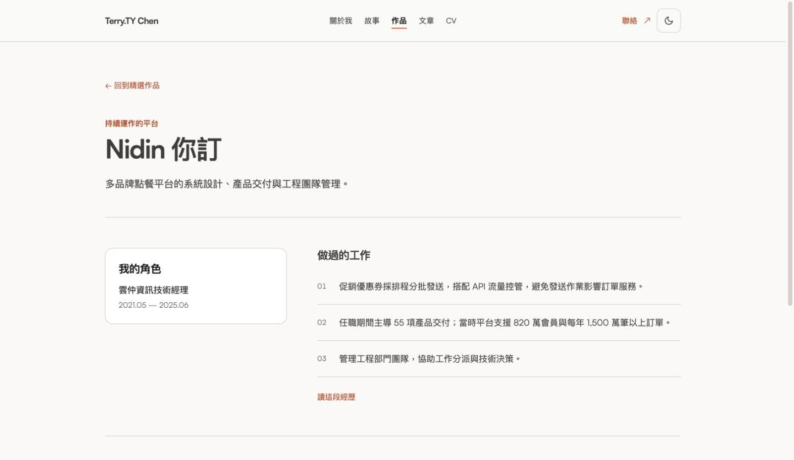
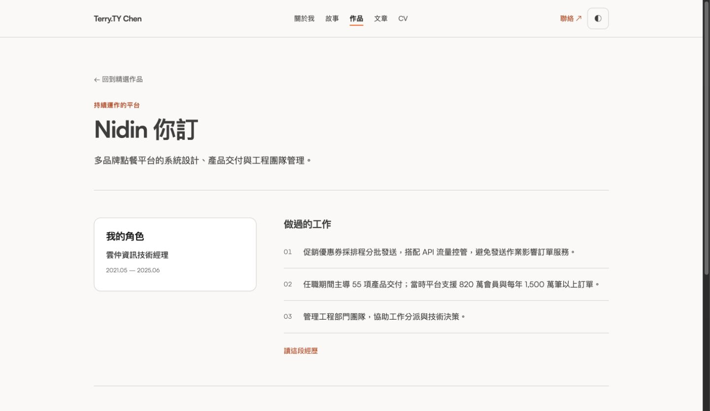

# Personal site design alignment evidence

The latest user instruction rewrites Nidin management responsibilities in both the website and the selected Open Design source. It supersedes deletion-only wording. The case keeps a populated third evidence row, `管理工程部門團隊，協助工作分派與技術決策。`; its role card keeps `雲仲資訊技術經理`. The English equivalent is `Managed the engineering team and supported work allocation and technical decision-making.`. Management headcount text and its statistic card are removed. The separately confirmed 55-delivery achievement and other companies’ team sizes remain.

## Authority and isolation

- Selected project: `/Users/terrychen/Library/Application Support/Open Design/namespaces/release-stable/data/projects/76e33fa9-e2bc-4bf3-b92d-b38f0e5c0ae2`.
- The initial alignment treated this source as read-only. The latest explicit instruction authorises edits to this exact project’s ordinary design files. Only `index.html`, `design.css` and `design-note.md` changed. App-owned artifact metadata, app databases, model settings, credentials and other projects were not edited. Notion was not changed.
- Before editing, PR #110 and the dedicated worktree both pointed to `e49899a06f875205dc99508de0f9559546560d54`; the worktree was clean. The original HTML/CSS/note hashes matched the previously inspected revision. Each source write was guarded against concurrent changes, with original files backed up under this task’s `evidence/design-before-nidin-management` directory.
- [Exact external design patch](evidence/2026-10-15-nidin-management-design.patch) and [before/after fingerprints](evidence/2026-10-15-nidin-management-design-change.json) make the ordinary-file edits reviewable without modifying Open Design’s app metadata.
- Current HTML SHA-256: `7bde014f870d6733da41a2c6fa70a888e0d186033ec02954870734d5a0c2bed6`; CSS: `c03209e98e0eebf98f0b4fb035217cbf9eeaf8013d177aca79e883d9b751e6e0`; design note: `28e4eb652b98ea3911e0e7d0d73004014dbb2eb5756f4a415a6984218014b6eb`. JavaScript remains `5637dc6b4f238c8c23cfe8b99f35ce88219133a669a4ed352c0db2ee699beef7`.
- Website changes remain isolated in `codex/jur-705-design-alignment`, under this task’s `site-alignment` worktree. The existing folder `.me` maps to canonical remote `terry90918/terry90918.github.io`; main and unrelated untracked files were not edited. Existing JUR-705 and PR #110 are reused.

## Per-view and content coverage

| View → route                                            | Current correction / retained contract                                                                                                                                                                                                                                     |
| ------------------------------------------------------- | -------------------------------------------------------------------------------------------------------------------------------------------------------------------------------------------------------------------------------------------------------------------------- |
| Shared shell                                            | Centered navigation, aligned content edges, 44px controls, shared palette and text footer remain from the earlier correction.                                                                                                                                              |
| home → `/`                                              | GJ, Nidin, AI order and selected copy remain. Generic engineering-team management wording stays; no management headcount.                                                                                                                                                  |
| about → `/about`                                        | Selected three introduction paragraphs and public account captions remain.                                                                                                                                                                                                 |
| story → `/story`                                        | GJ/Nidin/AI chapters, Nidin index 02 and selected paragraphs remain; generic management wording stays.                                                                                                                                                                     |
| work → `/work`                                          | Product/platform/AI order and concise supporting cards remain. Nidin’s role is now technical manager without a management headcount.                                                                                                                                       |
| work-gj → `/work/gj`                                    | Unrelated copy stays. Shared role-card sizing now fills its intended grid column.                                                                                                                                                                                          |
| work-nidin → `/work/nidin`                              | Role card retains technical-manager title, row 02 retains the confirmed 55 deliveries and platform scale, row 03 uses the approved responsibility sentence. Three populated rows remain.                                                                                   |
| work-jurislm → `/work/jurislm`                          | Unrelated facts and sampled-recall qualification stay. Shared role-card sizing follows the same grid fix.                                                                                                                                                                  |
| posts → `/posts`                                        | Selected static copy and current article data remain.                                                                                                                                                                                                                      |
| ai-daily → `/posts/ai-daily`                            | Selected intro, eyebrow and current daily data remain.                                                                                                                                                                                                                     |
| cv-zh-TW → `/cv`, `/cv/zh-TW`                           | Nidin experience metadata omits its management headcount. Its management bullet starts with the approved sentence; existing process/recruitment details remain. Three metric cards and all 31 confirmed skill categories remain.                                           |
| cv-en → `/cv/en`                                        | Same removal and approved English responsibility sentence. Other companies’ team sizes stay.                                                                                                                                                                               |
| CV Nidin case studies → `/cv/{locale}/case-study/nidin` | Both frontmatter roles retain only technical-manager titles. Both body bullets use the approved management sentence and retain the existing workflow/recruitment details. These narrow copy edits are explicitly authorised beyond the original prototype’s body coverage. |

Main copy lives in `lib/site/content.ts`; bilingual CV facts in `lib/cv/profile.ts`; the two Nidin MDX cases carry their matching metadata/body edits. `lib/site/design-reference.json` was regenerated from the updated design HTML. CV metrics use three desktop columns and two below 900px in both source CSS and runtime CSS, with no empty card.

Shorter role copy exposed inherited auto margins from the global `section` rule, shrinking the role card within its column. The scoped `.site-case-body > section` rule now resets margin/max-width and fills its grid width. Actual Chrome screenshots were inspected; the source and website role cards also reported the same x-position and width through read-only geometry checks. Other page section rules were not broadened.

## Copy audit

[Full source → implementation → status audit](2026-10-15-design-copy-audit.md): 862 entries across all 11 views, including repeated shared-shell checks and explicit numeric metric values. 857 static entries match within their mapped sections, with zero unexplained missing blocks. Whitespace and decorative arrows/plus signs are ignored. This checks copy coverage, not visual geometry, ordering or absence of extra copy.

- Three article slots use current data: 3 home updates, 92 archive rows and 77 daily rows. The prototype’s 71-post snapshot is not frozen into the product.
- Two prototype badge-name entries belong to the static placeholder. The real desktop 3D/physics card and mobile photo fallback remain.
- No factual-copy exception remains. The 55-delivery statement matches the selected source, and the approved management sentence replaces the former headcount statement.
- Searches across website sources, public textual assets and article content found no remaining former management-headcount expressions. Exported Work, Nidin case, both CV homes and both CV Nidin cases were checked separately. TPI’s existing team size remains, and regression tests assert that preservation.

## Persisted desktop evidence

Both are actual normal-Chrome screenshots of the revised case pages, 1441×837 JPEGs. The website screenshot is 47,184 bytes, SHA-256 `daeadec7800d8a50a61f40945a67f1d3e6edcb0bb0fd3e11574d4e64fc8408cb`. The design screenshot is 47,901 bytes, SHA-256 `912ff55e50949867714797ef49fda8105cf576cc89352e7e91b6ce7872a9c20c`.

The website image also updates the existing Library item `libfile_9b21d3e1e07081919af42a20ecf0499b`, version 1, filename `nidin-management-site.jpg`. The earlier capture remains historical evidence in Git/Library version history; it is not the current preview.

Website:

Selected Open Design source:

Local previews on Terry Mac: website `http://127.0.0.1:4318/work/nidin`; selected source `http://127.0.0.1:4317/?page=work&case=nidin`.

## Checks, review and remaining acceptance

- Targeted responsibility/headcount assertions first failed against the previous copy. Full lint/typecheck, all 103 tests across 16 files, OpenSpec 10/10, the 125-page production build, the 11-view copy audit and diff whitespace checks passed after the correction. OpenSpec’s optional analytics flush reported a network error after successful validation, exit 0; no configuration changed.
- The earlier complete Codex and CodeRabbit reviews finished on `14b120e`; their actionable findings were fixed at `0b68760`. Later copy deltas and this scoped card-sizing fix were self-inspected and checked locally. No additional complete or incremental provider review was requested.
- The latest commit’s own CI terminal readback is recorded in PR #110 and JUR-705 after pushing. Earlier successful pipeline #142 does not validate this follow-up. No manual CI rerun or budget change.
- Earlier normal-browser work covered desktop views and selected theme/menu/skills/language/3D interactions. This follow-up adds the focused desktop case comparison above. The full 320px/375px, keyboard/Escape/focus, reduced-motion and long-page acceptance matrix remains incomplete. Automated E2E was not executed and DOM counts are not treated as visual acceptance.
- PR #110 remains review-only, unmerged and undeployed. JUR-705 remains In Review pending the remaining visual acceptance.

## Later review-gate and E2E verification

The earlier browser/E2E limitations above are historical. The [review-gate and E2E follow-up](2026-10-15-review-gate-and-e2e.md) records recovered original Chrome acceptance, the completed initial Codex review versus a later automatic failed attempt, inspected deltas and a full 45/45 passing frontend E2E run. Product source remains identical to 248626f; only stale test assertions and verification records changed. No provider review was requested again, and no merge/deployment was performed.
