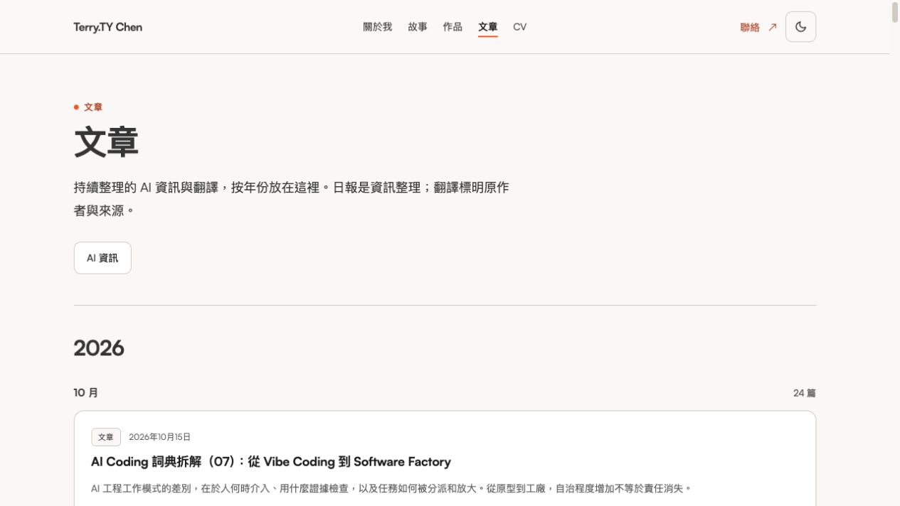
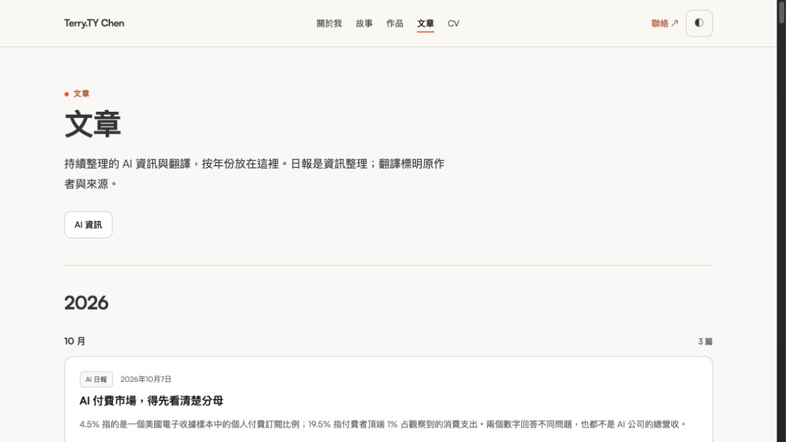

# Latest Writing navigation alignment

The selected Open Design HTML now contains only the **AI 資訊** entry in the Writing topic navigation. The user explicitly authorised syncing that later edit to the website in the existing PR. Remove the **軟體工程** and **按年份閱讀** shortcut buttons; keep the year-grouped archive, `all-posts` and article anchors, article contents, metadata and public URLs.

## Authority and scope

- Source project: `76e33fa9-e2bc-4bf3-b92d-b38f0e5c0ae2`.
- Current HTML SHA-256 before/after verification: `8ded8cadf1e4827eba2189f49cc17e9050b7868b281dbc2a6c4706bb0675dae2`.
- Read the current HTML, CSS/JS context, design note and supplied screenshot/drawing. The older screenshot shows three entries; the drawing highlights the group without an opposing textual instruction. Current HTML has one entry and JavaScript does not reintroduce the other two. There is no conflicting current implementation instruction.
- External design files, app metadata and other tasks were not modified. The website remains in its dedicated non-main worktree and PR #110.

The requested product change is limited to the Writing navigation and removal of its unused shortcut lookup. A subsequently published, verified P2 review finding also corrects only the Story/Work SEO descriptions to match their existing displayed sections; page bodies, titles, canonical URLs and personal facts are unchanged. The structured reference snapshot records the latest source fingerprint; its CV contents are unchanged. The E2E assertion now checks exactly one topic entry, its real series destination, and retention of both archive/article anchors. The full existing source-URL comparison remains in the suite.

## Verification

- The single-entry E2E assertion first failed against the previous three-button production export.
- Full project lint, typecheck, **104 unit tests / 16 files**, OpenSpec **10/10** and production build **125 pages** passed. OpenSpec's optional analytics flush reported DNS failure with exit 0; no configuration was changed.
- Rebuilt final-code frontend E2E: **45/45 passed (37.6s)** with the existing frontend project, timeouts, retries and behavior checks. [Output](evidence/2026-10-15-writing-topics-e2e.log).
- **159 article-source files remain byte-identical** to this follow-up's baseline. The E2E source comparison confirms all **92 published article URLs** remain; daily archive still contains 77 entries.
- Regenerated all-11-view audit against the latest HTML: **860 entries, 855 static matches, zero unexplained missing blocks**. Three current article slots and two interactive-badge entries remain separately documented. Unlike the text-coverage audit, the exact one-entry E2E assertion also checks absence of the extra navigation links.
- Normal supported Chrome screenshots were inspected for the website and selected source at desktop size, and the product at **375px and 320px**. Only AI 資訊 remains, content stays readable, no horizontal overflow was observed, and the actual series link works in E2E. Temporary viewport overrides were reset; the website preview is retained.
- Existing provider reviews and delta-verification rules remain applicable. No additional complete/incremental review was requested. This small follow-up does not change review or CI configuration.

## Actual evidence

Website desktop:

Latest selected design desktop:

Website at 375px:

[Fingerprints and preservation evidence](evidence/2026-10-15-writing-topics-manifest.json).

Local preview: `http://127.0.0.1:4318/posts`; design preview: `http://127.0.0.1:4317/?page=posts`. Dynamic articles/dates/counts intentionally use current product data rather than the prototype snapshot.

The previously outstanding two-entry design delta is resolved by this follow-up. Physical-device and other-browser-engine testing remain outside the verified scope. No merge or deployment was performed; the exact pushed head and its own CI terminal state are recorded in the PR handoff.

## Subsequent verified P2 metadata finding

The existing automatic review on `a1c5d7b` completed and published [a P2](https://github.com/terry90918/terry90918.github.io/pull/110#discussion_r4280263621): descriptions still advertised Story/Work sections removed by the earlier selected-copy alignment. Source inspection confirmed the mismatch. A regression assertion first failed against the obsolete descriptions. Corrected the two descriptions, verified identical description/Open Graph/Twitter values in unit tests and normal Chrome, and retained canonical URLs and visible page content.

One initial parallel unit/build run hit the existing 5-second homepage unit timeout while several build routes retried their existing 60-second limit. The build completed under its normal retry policy; after it finished, the same full unit suite passed 104/104 sequentially. No limits, retries, dependencies or configuration were changed. The final 45/45 passing E2E run (37.6s) supersedes the earlier navigation-only run. No additional review was requested.
